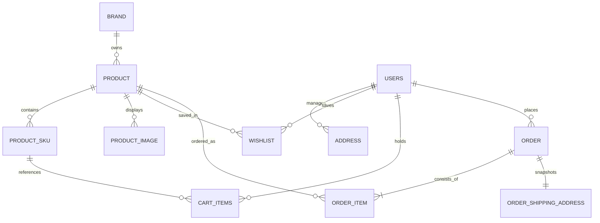

# Myntra Clone — E-Commerce Backend Engine

[](https://openjdk.org/)
[](https://spring.io/projects/spring-boot)
[](https://spring.io/projects/spring-security)
[](https://www.mysql.com/)
[](https://razorpay.com/)

A high-performance, modular e-commerce RESTful API backend engineered in **Java 21** and **Spring Boot**, modeled after Myntra's core marketplace infrastructure. It features catalog discovery, dynamic faceted search, bag and wishlist state management, address management, transactional checkout, and server-to-server cryptographic payment verification via Razorpay.

---

## Architecture & Engineering Highlights

* **Stateless Dual-Channel JWT Authentication**: Employs hardened `HttpOnly`, `SameSite=Lax` cookies to prevent Cross-Site Scripting (XSS) and Cross-Site Request Forgery (CSRF), alongside fallback support for standard `Authorization: Bearer <token>` headers.
* **Cryptographic Payment Validation**: Implements Razorpay payment verification with HMAC-SHA256 signature verification, server-side status checks, and exact amount comparison (with paise precision) to prevent client-side price tampering.
* **Transactional State Machine (`@Transactional`)**: Manages the complete order lifecycle (`PENDING` → `CONFIRMED` / `CANCELLED`), guaranteeing atomic inventory deduction and cart flushing upon successful settlement.
* **Address Snapshot ("Freeze") Pattern**: Decouples active delivery profiles from confirmed orders using `OrderShippingAddress` immutable records, preserving historical order integrity even if a user updates or deletes their saved addresses.
* **Domain-Driven Modular Organization**: Structured cleanly across bounded contexts (`catalog`, `cart`, `order`, `payment`, `user`) with strict entity-to-DTO separation to prevent schema leakage.

---

## Domain Architecture & Entity Relationships



---

## Implemented API Reference

### 1. Authentication & Security (`/auth`)
| Method | Endpoint | Access | Description |
| :--- | :--- | :--- | :--- |
| `POST` | `/auth/signup` | Public | Registers a new user with BCrypt-hashed password. |
| `POST` | `/auth/login` | Public | Validates credentials and sets an `HttpOnly` JWT cookie (`jwt_token`). |
| `POST` | `/auth/logout` | Public | Clears the session cookie with immediate expiration. |

### 2. Product Catalog & Search (`/gateway`)
| Method | Endpoint | Access | Description |
| :--- | :--- | :--- | :--- |
| `GET` | `/gateway/v4/search/{categorySlug}` | Public | Category listings with pagination (`p`, `rows`), dynamic filters (`f`), and contextual user wishlist indicators. |
| `GET` | `/gateway/v2/product/{id}/details` | Public | Detailed product view including images, brand details, pricing, discount labels, and available SKU sizes. |
| `GET` | `/gateway/v1/search/autosuggest?q={query}` | Public | Real-time search query suggestions for titles and brands. |

### 3. Shopping Cart (`/gateway/v1/cart/default`)
| Method | Endpoint | Access | Description |
| :--- | :--- | :--- | :--- |
| `POST` | `/gateway/v1/cart/default/add` | Authenticated | Adds a specific SKU size and quantity to the user's cart. |
| `GET` | `/gateway/v1/cart/default/checkout/cart` | Authenticated | Retrieves current cart summary with computed subtotal, itemized discount breakdown, shipping fees, and net total. |
| `PUT` | `/gateway/v1/cart/default/edit` | Authenticated | Updates quantity for an existing cart item. |
| `PUT` | `/gateway/v1/cart/default/remove` | Authenticated | Removes an item from the cart. |

### 4. Wishlist (`/wishlist`)
| Method | Endpoint | Access | Description |
| :--- | :--- | :--- | :--- |
| `POST` | `/wishlist/{productId}` | Authenticated | Adds a product to the authenticated user's wishlist. |
| `DELETE` | `/wishlist/{productId}` | Authenticated | Removes a product from the wishlist. |
| `GET` | `/wishlist/` | Authenticated | Fetches all items in the user's wishlist with full product metadata. |

### 5. Address Book (`/v2/addresses`)
| Method | Endpoint | Access | Description |
| :--- | :--- | :--- | :--- |
| `POST` | `/v2/addresses/` | Authenticated | Adds a new shipping address. |
| `PUT` | `/v2/addresses/unifiedIds/{addressId}` | Authenticated | Updates an existing address owned by the caller. |
| `DELETE` | `/v2/addresses/unifiedIds/{addressId}` | Authenticated | Soft/hard deletes an address by ID. |
| `GET` | `/v2/addresses/my/address` | Authenticated | Lists all saved delivery addresses for the user. |

### 6. Orders & Checkout (`/orders`)
| Method | Endpoint | Access | Description |
| :--- | :--- | :--- | :--- |
| `POST` | `/orders` | Authenticated | Places an order from the cart. Supports Cash on Delivery (`COD`) and Online Payment (`ONLINE` via Razorpay). |
| `GET` | `/orders` | Authenticated | Retrieves order history for the logged-in user. |
| `GET` | `/orders/{orderId}` | Authenticated | Returns detailed status, snapshot delivery address, and line items for a specific order. |
| `PUT` | `/orders/{orderId}/cancel` | Authenticated | Cancels an eligible pending order. |

### 7. Payment Verification (`/payments`)
| Method | Endpoint | Access | Description |
| :--- | :--- | :--- | :--- |
| `POST` | `/payments/verify` | Authenticated | Validates Razorpay `razorpay_order_id`, `razorpay_payment_id`, and HMAC-SHA256 signature, triggers stock deduction, marks order as `CONFIRMED` / `PAID`, and clears the cart. |

---

## Core Technical Decisions

### 1. Payment Verification & Anti-Tampering Flow
Online payments must never trust client-reported success flags:
1. **Pre-order creation**: Upon `POST /orders` with `ONLINE` payment method, a server-to-server call initializes an order with Razorpay in paise. The Razorpay `order_id` is linked to our internal order record.
2. **Signature verification**: When the frontend client submits checkout credentials to `POST /payments/verify`, the backend calculates `HMAC_SHA256(razorpay_order_id + "|" + razorpay_payment_id, secret)` and asserts mathematical equality against `razorpay_signature`.
3. **Capture & Amount Integrity**: The backend queries Razorpay directly to confirm the payment status is `"captured"` and validates that the captured monetary value equals `order.totalAmount * 100`.
4. **Idempotency**: Repeated callbacks or re-verifications for already-processed orders are handled gracefully without duplicate inventory deductions.

### 2. Preventing Historical Order Mutation
When users change their home or delivery address, past orders must retain the exact shipping location at the moment of purchase. The engine clones the selected `Address` into a dedicated `OrderShippingAddress` snapshot entity upon order creation, ensuring billing and shipping compliance.

### 3. SKU-Level Inventory Control
Stock is maintained per `ProductSku` (e.g. Size `M` vs `XL`) rather than at the generic `Product` level. During checkout and payment confirmation, stock availability is re-validated before execution to prevent overselling.

---

## Tech Stack

| Component | Technology | Description |
| :--- | :--- | :--- |
| **Language** | Java 21 | Modern LTS Java release utilizing records and pattern matching |
| **Framework** | Spring Boot 4.x | Cloud-ready REST application runtime |
| **Security** | Spring Security & JJWT 0.12.6 | Stateless JWT authorization filter and BCrypt password encryption |
| **Persistence** | Spring Data JPA / Hibernate | Object-relational mapping and transactional boundaries |
| **Database** | MySQL 8 | Relational data store |
| **Payment Gateway** | Razorpay Java SDK 1.4.3 | Payment order lifecycle and signature verification |
| **Build Tool** | Apache Maven | Dependency management and build packaging |

---

## Local Setup & Installation

### 1. Prerequisites
* **Java Development Kit (JDK) 21** or higher
* **MySQL 8.0+**
* **Apache Maven 3.8+** (or use included `mvnw`)

### 2. Configure Database & Secrets
Create a MySQL database:
```sql
CREATE DATABASE myntra_clone;
```

Copy the example configuration to initialize your local properties:
```bash
cp src/main/resources/application.properties.example src/main/resources/application.properties
```

Update `src/main/resources/application.properties` with your database credentials and Razorpay API test keys:
```properties
# Database Connection
spring.datasource.url=jdbc:mysql://localhost:3306/myntra_clone
spring.datasource.username=YOUR_DB_USERNAME
spring.datasource.password=YOUR_DB_PASSWORD

# Razorpay API Credentials
razorpay.key.id=YOUR_RAZORPAY_KEY_ID
razorpay.key.secret=YOUR_RAZORPAY_KEY_SECRET
```

> [!NOTE]
> `application.properties` is protected by `.gitignore` to prevent credential exposure. Never commit active API keys or credentials.

### 3. Build & Run
Run the application using the Maven wrapper:
```bash
./mvnw clean compile
./mvnw spring-boot:run
```

By default, the server starts on `http://localhost:8080`.

---

## Project Structure

```
src/main/java/com/myntra/clone/
├── CloneApplication.java           # Spring Boot entry point
├── catalog/                        # Product catalog & search context
│   ├── controller/                 # ProductListing, ProductDetail, Search controllers
│   ├── dto/                        # Catalog projection records & response envelopes
│   ├── entity/                     # Brand, Product, ProductSku, ProductImage
│   ├── repository/                 # Spring Data JPA repositories
│   └── service/                    # Catalog query & autosuggest implementations
├── cart/                           # Shopping bag context
│   ├── controller/                 # Cart endpoints (add, edit, remove, summary)
│   ├── dto/                        # Cart mutation & response records
│   ├── entity/                     # CartItems entity
│   ├── repository/                 # CartRepository
│   └── Service/                    # Bag calculation & stock verification
├── order/                          # Order processing & lifecycle context
│   ├── controller/                 # Order creation & tracking controllers
│   ├── dto/                        # Order placement & summary records
│   ├── entity/                     # Order, OrderItem, OrderShippingAddress
│   ├── repository/                 # Order repositories
│   └── Service/                    # Order orchestration & address snapshotting
├── payment/                        # Payment gateway context
│   ├── config/                     # Razorpay client bean configuration
│   ├── controller/                 # Payment verification controller
│   ├── dto/                        # Payment verification payloads
│   └── service/                    # Signature validation & stock deduction
└── user/                           # User management & authentication context
    ├── config/                     # SecurityConfig, CORS, JwtAuthenticationFilter
    ├── controller/                 # Auth, Address, and Wishlist controllers
    ├── dto/                        # Auth, Address, and Wishlist DTOs
    ├── entity/                     # Users, Address, Wishlist
    ├── repository/                 # User repositories
    └── service/                    # AuthService, JwtService, AddressService, WishlistService
```
